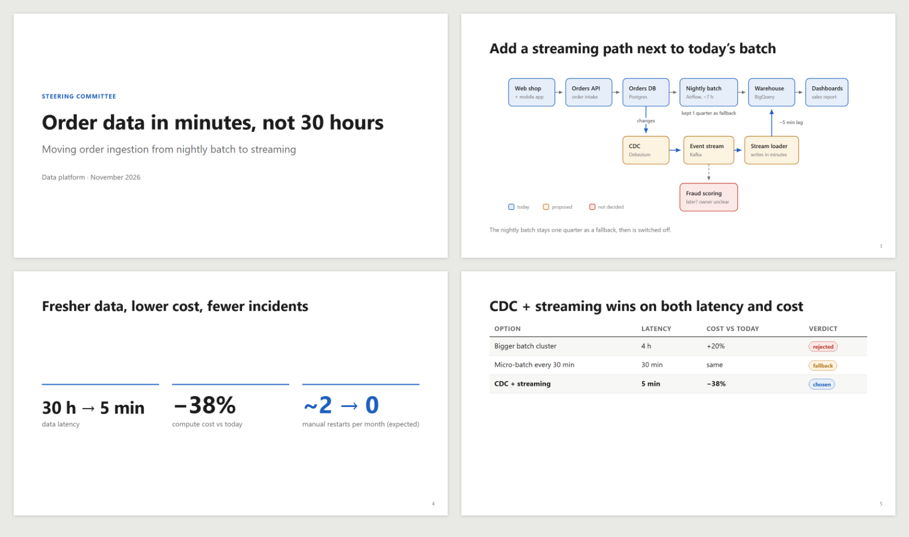

# skills-for-agents

Skills that let a coding agent (Claude Code, Codex, Cursor, Copilot, Gemini CLI) produce documentation
people actually look at — slide decks and diagrams in one consistent style — and **check its own
output before handing it to you**.

## What you can ask

> **"Make a 6-slide deck for the steering committee from design-note.md, with an architecture diagram
> that shows what exists today and what is proposed. I also need a PDF to send."**



<sub>Real, unedited output of one Claude Code run on that sentence. Input: [design-note.md](.github/media/design-note.md) ·
result: [the PDF](.github/media/story-deck.pdf).</sub>

You get a single HTML file (open it in any browser, arrow keys to present) and a PDF. Behind the scenes the
agent picked a layout per slide, drew the diagram with a status legend, ran a layout check for overflowing,
clipped or too-small text, looked at a screenshot of every slide, fixed what it found — and told you what
it had to assume (*"the note has no author or date, so the title slide says 'Data platform · November 2026'"*).

Other requests the skills are built for:

| You say | You get |
|---|---|
| "Turn these meeting notes into 5 slides for Monday" | a deck in the same style as every other deck you make |
| "Draw how an order flows through our services; mark what's confirmed, proposed and still unclear" | an SVG/PNG diagram with a status legend |
| "Make a flowchart of the release process from RELEASE.md" | a Mermaid diagram rendered in the same theme |
| "Restyle the deck in our brand colour #0f766e" | the same deck and diagrams, recoloured from one theme file |
| "Put the architecture diagram on a slide after the problem statement" | the diagram inlined in the deck, still one file |

## Install

**Claude Code** — one plugin, two skills (`skills-for-agents:slides`, `skills-for-agents:diagrams`):

```text
/plugin marketplace add dryabokon/skills-for-agents
/plugin install skills-for-agents@dryabokon
```

**Other agents** read the same `skills/<name>/` folders:

```bash
npx skills add dryabokon/skills-for-agents                                            # Codex, Cursor, ... (.agents/skills/)
gh skill install dryabokon/skills-for-agents slides                                  # GitHub Copilot (gh preview)
gemini skills install https://github.com/dryabokon/skills-for-agents --path skills/slides   # Gemini CLI
```

**Requirements:** Python 3.9+ and a Chromium-based browser (Chrome, Edge, Chromium) — no pip packages.
Mermaid diagrams also need Node.js 18+. No Chrome (Linux, WSL, CI)? One command, no root:
`npx @puppeteer/browsers install chrome-headless-shell@stable --path ~/.cache/puppeteer`.

## Skills

| Skill | Does | Details |
|---|---|---|
| **slides** | single-file HTML decks, 16:9, 8 layouts (title, section, bullets, two columns, big numbers, figure, quote, table), PDF export, layout check, screenshots | [SKILL.md](skills/slides/SKILL.md) · [layouts](skills/slides/references/layouts.md) |
| **diagrams** | Mermaid for quick auto-layout, hand-made SVG when layout matters; one theme and status legend (confirmed / proposed / unclear); geometry check | [SKILL.md](skills/diagrams/SKILL.md) · [SVG conventions](skills/diagrams/references/svg-conventions.md) |

Your style: colours and fonts are CSS variables. Put `:root { --accent: #0f766e; }` into `.agent-theme.css`
in your project and every deck and diagram the agent makes there follows it.

## See it without an agent

Every skill ships `examples/*.sh` — plain lists of the same commands the agent runs, so you can reproduce
any result by hand:

```bash
git clone https://github.com/dryabokon/skills-for-agents
cd skills-for-agents/skills/slides   && bash examples/build-a-deck.sh    # -> out/streaming.html, .pdf, -shots/
cd ../diagrams && bash examples/svg-and-check.sh                          # -> themed SVG + what the check reports
cd ../diagrams && bash examples/mermaid-flow.sh                           # -> Mermaid flowchart, SVG + PNG
```

<details>
<summary>WSL: use the Windows fonts so renders match Windows</summary>

```bash
mkdir -p ~/.config/fontconfig && printf '<?xml version="1.0"?>\n<fontconfig><dir>/mnt/c/Windows/Fonts</dir></fontconfig>\n' > ~/.config/fontconfig/fonts.conf && fc-cache -f
```
</details>

## Contributing

```
skills/<name>/   SKILL.md · scripts/ (one CLI) · assets/ (templates, theme) · references/ · examples/*.sh
.claude-plugin/  plugin + marketplace manifests        .github/  CI and check.py
```

`python .github/check.py` validates the Agent Skills spec rules, that every skill has an example, that files
two skills both carry (`scripts/_browser.py`, `assets/theme.css`) stay identical, secrets, and
`claude plugin validate`. A skill never reaches outside its own folder; no credentials or company-specific
hosts in code.

## License

[MIT](LICENSE)
