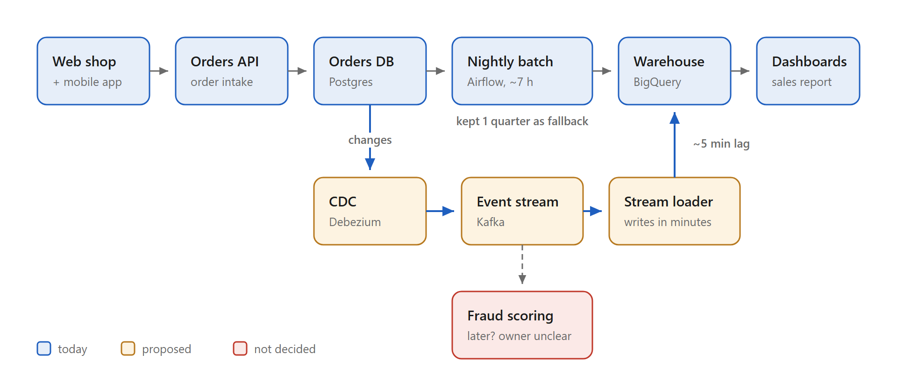
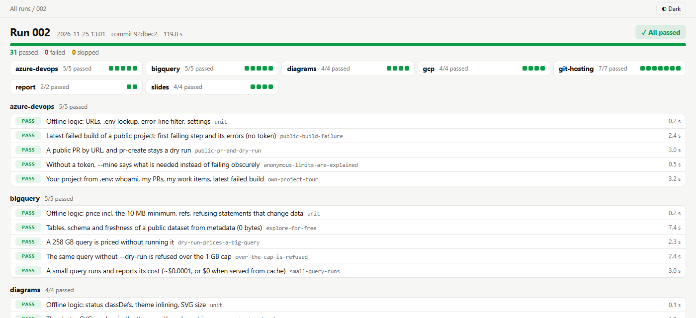

# skills-for-agents

Your coding agent, finishing the work around the code: **slide decks, diagrams and reports** in one consistent
style, and **straight answers about your PRs, builds, data and cloud**. It checks its own result before handing
it over, and it never changes anything without showing you the plan first.

Works with Claude Code, Codex, Cursor, Copilot and Gemini CLI.

## How to ask

Name the skill, then say what you need:

```text
/skills-for-agents:<skill>  <what>, from <which data>, for <whom> — save as <file>
```

Naming the skill is what makes the result reliable: the agent then uses the skill's tools, style and checks
instead of improvising. (Other agents: start with *"Use the &lt;skill&gt; skill"*.)

## What you can ask

| Skill | Prompt | You get |
|---|---|---|
| **slides** | `/skills-for-agents:slides` Turn design-note.md into 6 slides for the steering committee, with an architecture diagram. Save deck.html and a PDF. | one-file deck + PDF, every slide checked for overflow |
| **diagrams** | `/skills-for-agents:diagrams` Draw how an order flows through our services; mark what exists, what is proposed and what is undecided. | SVG + PNG with a status legend |
| **report** | `/skills-for-agents:report` Report on runs/007/results.json — what failed and why, failures first. Save runs/007/index.html. | one HTML page, verdict first, light/dark |
| **azure-devops** | `/skills-for-agents:azure-devops` Why did the last build of develop fail? | the failing step, the error that matters, the fix |
| **git-hosting** | `/skills-for-agents:git-hosting` Where are my open PRs stuck? | missing approvals, failing checks, open threads |
| **bigquery** | `/skills-for-agents:bigquery` Which tables in analytics stopped updating this week? | stale and empty tables, found from free metadata |
| **gcp** | `/skills-for-agents:gcp` Deploy this folder to Cloud Run behind Google sign-in. | the exact gcloud plan, run only after your yes |

## What it looks like

| Slides | Diagram | Report |
|---|---|---|
| [](.github/media/story-deck.pdf) |  |  |

<sub>Real output. Slides and diagram: one Claude Code run on the prompt above with
[design-note.md](.github/media/design-note.md) (click for the PDF). Report: this repository's own test run.</sub>

And an answer from a service skill — *"Why did the last failed build fail?"* on a public CI:

> **Root cause:** step *Build shared fx* failed NuGet restore — `NU1603`: `Microsoft.Extensions.*` 10.11.1 is not on
> the feeds, 11.0.0 was resolved, warnings are errors. *Monitor Helix Jobs* failed only as a consequence.
> **Fix:** update the versions through the dependency flow; don't silence NU1603.

## Install

```text
/plugin marketplace add dryabokon/skills-for-agents
/plugin install skills-for-agents@dryabokon
```

Other agents: `npx skills add dryabokon/skills-for-agents`. Needs Python 3.9+ and Chrome or Edge; BigQuery and
Cloud Run use your `gcloud` sign-in. Tokens go into `.env` — template: [.env.example](.env.example).

## Safe by default

Read-only unless you ask. Creating a PR, deploying or uploading is shown as a plan and runs only after you
confirm; nothing merges, approves or deletes. BigQuery prices every query first and refuses anything over your cap.
Tokens are never printed.

Every skill can be run by hand with the same commands (`skills/<name>/examples/*.sh`), and `python tests/run.py`
tests them all.
